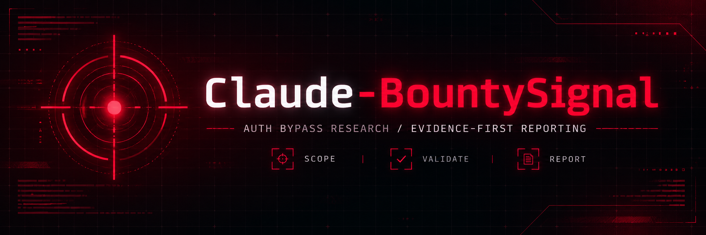

# Claude-BountySignal



> Evidence-first authentication and authorization research for Claude Code.

[](CHANGELOG.md)
[](LICENSE)
[](SECURITY.md)

Claude-BountySignal is a Claude Code plugin for authorized bug bounty research. It helps security researchers turn authentication and authorization observations into bounded hypotheses, reproducible validation records, and remediation-ready reports.

The primary skill is `hunt-auth-bypass`.

## Why this project exists

Security testing often fails at the handoff between “something looks wrong” and “this is a defensible finding.” Claude-BountySignal keeps that handoff explicit:

```text
scope → map identity → form hypothesis → validate safely → preserve evidence → report clearly
```

It is intentionally focused. The first release does not try to be a general-purpose scanner or a large collection of unrelated security prompts.

## What it covers

| Area | Examples |
| --- | --- |
| Authentication | Login, logout, registration, account recovery |
| Sessions | Cookie lifecycle, expiry, revocation, session changes |
| Step-up controls | MFA and recovery-flow consistency |
| Tokens | JWT and bearer-token handling hypotheses |
| Authorization | Roles, tenants, protected actions, IDOR/BOLA hypotheses |
| Boundary checks | Route, method, gateway, and backend inconsistencies |
| Reporting | Redacted evidence, validation status, remediation guidance |

## Install

Install the repository as a Claude Code plugin using your normal plugin workflow. For local development, clone the repository and load the plugin from its checkout.

```bash
git clone https://github.com/zetachess/Claude-BountySignal.git
cd Claude-BountySignal
```

The primary skill is:

```text
hunt-auth-bypass
```

## Commands

| Command | Purpose |
| --- | --- |
| `/auth-audit` | Build a bounded identity, role, and session review plan |
| `/auth-validate` | Separate facts from assumptions and validate an observation |
| `/auth-report` | Draft a concise, reproducible vulnerability report |

## Example workflow

```text
1. Run /auth-audit against an explicitly authorized target.
2. Map anonymous, basic-user, peer-user, and approved privileged states.
3. Choose a low-impact, reversible hypothesis.
4. Use /auth-validate to compare expected and observed behavior.
5. Redact evidence and use /auth-report only after validation.
```

Every candidate receives one of four statuses:

- `confirmed`
- `not reproducible`
- `needs more evidence`
- `out of scope`

## Safety boundary

Use Claude-BountySignal only against systems you own, approved labs, or assets covered by explicit written authorization.

Do not use it to:

- obtain or guess credentials;
- access unrelated accounts or records;
- evade rate limits or engagement controls;
- collect unnecessary personal data;
- expand scope from a redirect, hostname, email address, or third-party service.

Use synthetic identities and redacted evidence whenever possible. See [SECURITY.md](SECURITY.md) for the project policy.

## Repository layout

```text
.claude-plugin/       Plugin metadata
skills/               Claude Code skills
commands/             Slash commands
templates/             Report templates
evals/cases/          Synthetic validation cases
docs/                 Project and social-preview documentation
scripts/              Local validation scripts
```

## Evaluation cases

The repository includes seven synthetic cases covering:

- unauthenticated access;
- broken object-level authorization;
- role escalation hypotheses;
- invalid session reuse;
- valid authorization and false positives;
- insufficient evidence;
- out-of-scope targets.

Run the local structural check from PowerShell:

```powershell
.\scripts\validate.ps1
```

## GitHub topics

```text
ai-security, anthropic, application-security, bug-bounty, bugbounty,
bugcrowd, claude, claude-code, claude-skills, ethical-hacking,
hackerone, offensive-security, pentesting, red-team, security-tools,
web-security
```

## Roadmap

- Improve synthetic evaluations and regression coverage.
- Add more session, OAuth/OIDC, JWT, and MFA review patterns.
- Add a controlled practice-lab package.
- Consider Burp and standalone CLI integrations after the core workflow is stable.

## Project status

Version `0.1.0` is the initial focused release. The project is experimental and should be reviewed against the rules of each bug bounty program before use.

## Contributing

Read [CONTRIBUTING.md](CONTRIBUTING.md) before opening a change. New checks should explain their preconditions, safe validation approach, evidence requirements, and remediation direction.

> Built for Claude Code. Not an official Anthropic product.

## License

The original source code and documentation in this repository are released under the MIT License. See [LICENSE](LICENSE).
