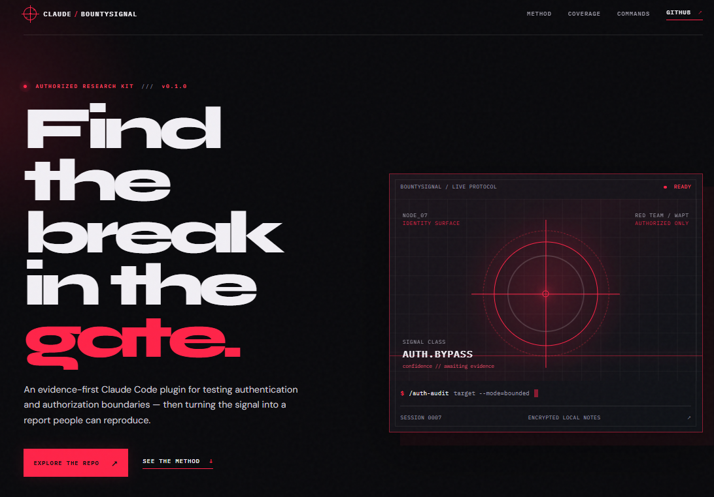

<a id="readme-top"></a>

<div align="center">
  <a href="https://github.com/zetachess/Claude-BountySignal">
    
  </a>

  <h1>Claude-BountySignal</h1>

  <p>
    Evidence-first authentication and authorization research for Claude Code.
    <br />
    Built for authorized bug bounty work.
    <br />
    <a href="https://github.com/zetachess/Claude-BountySignal/issues">Report a problem</a>
    ·
    <a href="https://github.com/zetachess/Claude-BountySignal/issues">Request an improvement</a>
  </p>

  <p>
    <a href="https://github.com/zetachess/Claude-BountySignal/releases"></a>
    <a href="https://github.com/zetachess/Claude-BountySignal/blob/main/LICENSE"></a>
    <a href="https://github.com/zetachess/Claude-BountySignal/blob/main/SECURITY.md"></a>
  </p>
</div>

## Table of Contents

- [About the Project](#about-the-project)
- [What It Covers](#what-it-covers)
- [Getting Started](#getting-started)
- [Usage](#usage)
- [Evaluation Cases](#evaluation-cases)
- [Roadmap](#roadmap)
- [Contributing](#contributing)
- [Security and Scope](#security-and-scope)
- [License](#license)
- [Project Link](#project-link)

## About the Project

Claude-BountySignal is a focused Claude Code plugin for authorized authentication and authorization research. It helps turn a suspicious behavior into a bounded hypothesis, a reproducible validation record, and a report that another researcher or triager can verify.

The workflow is deliberately simple:

```text
scope → map identity → form hypothesis → validate safely → preserve evidence → report clearly
```

The project is not a general-purpose scanner. It focuses on reasoning, controlled comparisons, evidence quality, and false-positive reduction.

The companion [landing page source](site/index.html) contains the project's visual presentation and can be deployed as a static site.

<p align="right">(<a href="#readme-top">back to top</a>)</p>

## What It Covers

| Area | Examples |
| --- | --- |
| Authentication | Login, logout, registration, and account recovery |
| Sessions | Cookie lifecycle, expiry, revocation, and session changes |
| Step-up controls | MFA and recovery-flow consistency |
| Tokens | JWT and bearer-token handling hypotheses |
| Authorization | Roles, tenants, protected actions, and IDOR/BOLA hypotheses |
| Boundaries | Route, method, gateway, and backend inconsistencies |
| Reporting | Redacted evidence, validation status, and remediation guidance |

<p align="right">(<a href="#readme-top">back to top</a>)</p>

## Getting Started

### Prerequisites

- Claude Code or a compatible Claude Code plugin environment.
- An explicitly authorized target, approved lab, or owned application.
- Non-production test identities where role comparisons are required.

### Installation

Clone the repository and load it through your normal Claude Code plugin workflow:

```bash
git clone https://github.com/zetachess/Claude-BountySignal.git
cd Claude-BountySignal
```

The plugin metadata is stored in `.claude-plugin/plugin.json`. The main skill is located at:

```text
skills/hunt-auth-bypass/SKILL.md
```

### Local validation

Run the structural and secret-pattern checks from PowerShell:

```powershell
.\scripts\validate.ps1
```

<p align="right">(<a href="#readme-top">back to top</a>)</p>

## Usage

Claude-BountySignal provides three focused commands:

| Command | Purpose |
| --- | --- |
| `/auth-audit` | Build a bounded identity, role, and session review plan |
| `/auth-validate` | Separate facts from assumptions and validate an observation |
| `/auth-report` | Draft a concise, reproducible vulnerability report |

### Recommended workflow

1. Start with `/auth-audit` and confirm the exact authorized scope.
2. Map anonymous, basic-user, peer-user, and approved privileged states.
3. Choose a low-impact and reversible hypothesis.
4. Use `/auth-validate` to compare expected and observed behavior.
5. Redact evidence and use `/auth-report` only after validation.

Every candidate should end in one of four statuses:

- `confirmed`
- `not reproducible`
- `needs more evidence`
- `out of scope`

<p align="right">(<a href="#readme-top">back to top</a>)</p>

## Evaluation Cases

The repository contains synthetic cases for:

- unauthenticated access;
- broken object-level authorization;
- role escalation hypotheses;
- invalid session reuse;
- valid authorization and false positives;
- insufficient evidence;
- out-of-scope targets.

These cases are designed to test reasoning and safety boundaries, not to target real systems.

<p align="right">(<a href="#readme-top">back to top</a>)</p>

## Landing Page

The repository includes a static product landing page in [`site/`](site/), designed for deployment on Vercel.

### Local preview

```powershell
python -m http.server 4173 --directory site
```

Open `http://127.0.0.1:4173` in a browser.

### Vercel deployment

Import this repository into Vercel. The included [`vercel.json`](vercel.json) configures `site/` as the deployment output directory, so no framework build step is required.

<p align="right">(<a href="#readme-top">back to top</a>)</p>

## Roadmap

- Expand session, OAuth/OIDC, JWT, and MFA review patterns.
- Add more regression cases for false positives and incomplete evidence.
- Add a controlled practice-lab package.
- Consider Burp and standalone CLI integrations after the core workflow is stable.
- Add optional translations without changing the English source of truth.

See the [open issues](https://github.com/zetachess/Claude-BountySignal/issues) for planned improvements.

<p align="right">(<a href="#readme-top">back to top</a>)</p>

## Contributing

Contributions are welcome when they make authorized testing safer, clearer, or more reproducible.

Before opening a pull request:

1. Read [CONTRIBUTING.md](CONTRIBUTING.md).
2. Use synthetic examples and redacted evidence.
3. Explain preconditions, safe validation, evidence requirements, and remediation.
4. Run `.\scripts\validate.ps1` locally.

<p align="right">(<a href="#readme-top">back to top</a>)</p>

## Security and Scope

Use Claude-BountySignal only against systems you own, approved labs, or assets covered by explicit written authorization.

Do not use it to obtain or guess credentials, access unrelated accounts, evade rate limits, collect unnecessary personal data, or expand scope from a redirect, hostname, email address, or third-party service.

Read [SECURITY.md](SECURITY.md) before testing.

> Built for Claude Code. Not an official Anthropic product.

<p align="right">(<a href="#readme-top">back to top</a>)</p>

## License

Claude-BountySignal is released under the MIT License. See [LICENSE](LICENSE) for the full text.

<p align="right">(<a href="#readme-top">back to top</a>)</p>

## Project Link

<a href="https://github.com/zetachess/Claude-BountySignal">https://github.com/zetachess/Claude-BountySignal</a>

<p align="right">(<a href="#readme-top">back to top</a>)</p>
